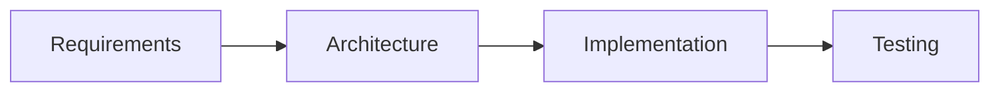

# Documentation Site Development — PAL Rule

This rule teaches the AI agent how to develop, maintain, and extend the
MkDocs Material documentation site. It is installed by the PAL
`install.sh --docs`.

## Content Merge Architecture

The docs site merges process and mapping content into a single MkDocs `docs_dir`:

```
build.sh workflow:
  1. Create .docs-build/
  2. Copy processes/ -> .docs-build/processes/
  3. Copy mappings/ -> .docs-build/mappings/
  4. Copy CATALOG.md, VERSION-POLICY.md, etc -> .docs-build/
  5. Copy index.md and stylesheets from docs-site/
  6. Run: mkdocs build -f .docs-build/mkdocs.yml
  7. Output: docs-site/site/
```

**Critical rules:**
- NEVER edit files in `.docs-build/` — it is ephemeral and rebuilt every time
- ALWAYS edit source files in `processes/` or `mappings/` directly
- Nav paths in `mkdocs.yml` use the `.docs-build/` relative layout:
  - `processes/base/lifecycle/PROC-LC-001.md` (from `processes/`)
  - `mappings/iso-12207.md` (from `mappings/`)
  - `CATALOG.md` (from repo root)

## Navigation Management

The `nav:` section in `docs-site/mkdocs.yml` uses explicit file paths.
When adding a new page:

1. Create the source file in its correct directory
2. Add the nav entry in `mkdocs.yml` under the correct section
3. Use the merged-content path (as listed above)
4. Run `bash docs-site/validate-site.sh --nav` to verify

### Section ordering conventions

- **Process Framework:** CATALOG first, then by category
- **Standards Mappings:** by standard name

## Markdown Extensions Available

The site supports these MkDocs Material extensions:

### Admonitions
```markdown
!!! note "Title"
    Content here.

!!! warning
    Warning content.

??? tip "Collapsible"
    Hidden until clicked.
```

### Custom admonitions (PAL-specific)
```markdown
!!! quality-gate "Quality Gate 3.1"
    All test evidence documented.

!!! entry-criteria "Entry Criteria"
    - REQ document approved
    - Stakeholder sign-off obtained

!!! exit-criteria "Exit Criteria"
    - All quality gates passed
    - Peer review completed
```

### Tabbed content
```markdown
=== "Python"
    ```python
    print("hello")
    ```

=== "Bash"
    ```bash
    echo "hello"
    ```
```

### Mermaid diagrams
````markdown

````

### Task lists
```markdown
- [x] Completed task
- [ ] Pending task
```

### Code blocks with copy button
````markdown
```python title="example.py"
def hello():
    print("world")
```
````

## Custom CSS

`docs-site/stylesheets/extra.css` provides:

### Status badges
```html
<span class="status status-draft">draft</span>
<span class="status status-active">active</span>
<span class="status status-deprecated">deprecated</span>
<span class="status status-superseded">superseded</span>
```

### Version chip
```html
<span class="version-chip">v1.0.0</span>
```

### Process category cards
```html
<div class="process-category process-category-lifecycle" markdown>
### Lifecycle Processes
Content here...
</div>
```

To add new badge types, edit `extra.css` and follow the existing patterns.

## Theme Customization

The `overrides/main.html` file extends Material's base template:

- **Footer:** displays `PAL docs vX.Y.Z (build N)` from `site.json`
  values injected at build time via `mkdocs.yml` `extra:` config
- **Analytics:** add tracking in the `extrahead` block if needed
- **Announcements:** use the `announce` block for site-wide banners

## Site Versioning

`docs-site/site.json` tracks build metadata:

- **version** — semver for the site itself (independent of product version)
- **buildNumber** — incremented on every `--prod` build
- **contentHash** — SHA-256 of all source markdown; detects actual content changes
- **pageCount / siteSize** — recorded for trend tracking

### When to bump version

| Change | Bump |
|--------|------|
| Content edits, CSS tweaks, typo fixes | PATCH |
| New section/tab, navigation restructured, new theme feature | MINOR |
| Full redesign, breaking URL changes, navigation overhaul | MAJOR |

Use `/pal-docs-deploy` to handle version bumps during deployment.

## Validation

Run `bash docs-site/validate-site.sh` to check:
1. All nav entries point to existing files
2. No duplicate nav entries
3. No orphan pages (files not in nav)
4. Cross-references resolve
5. site.json is valid

Run after:
- Adding or removing any page
- Editing mkdocs.yml
- Before committing docs changes
- Before deploying

## Deployment

The site deploys to GitHub Pages via `.github/workflows/docs.yml`:
- Triggers on pushes to `main` that touch `processes/`, `mappings/`, or `docs-site/`
- Also supports manual `workflow_dispatch`
- Uses `build.sh --prod` then uploads to GitHub Pages

For manual deployment, use `/pal-docs-deploy`.
