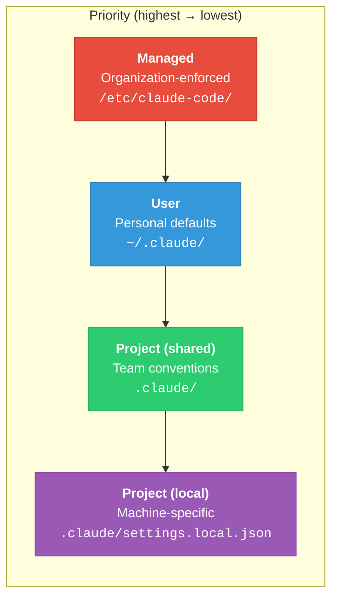
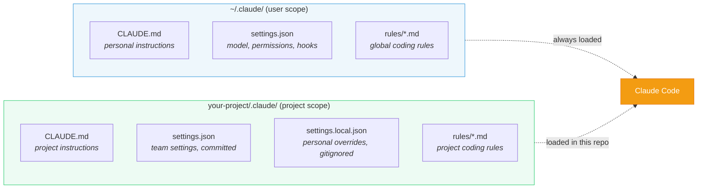
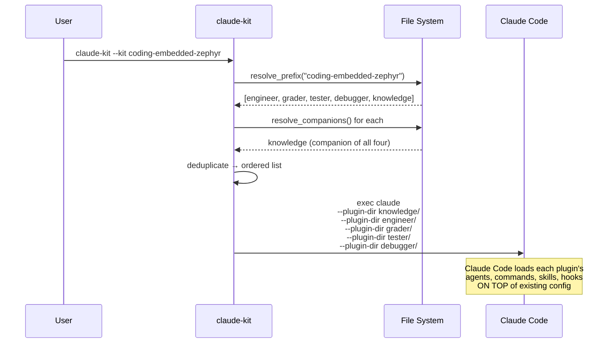
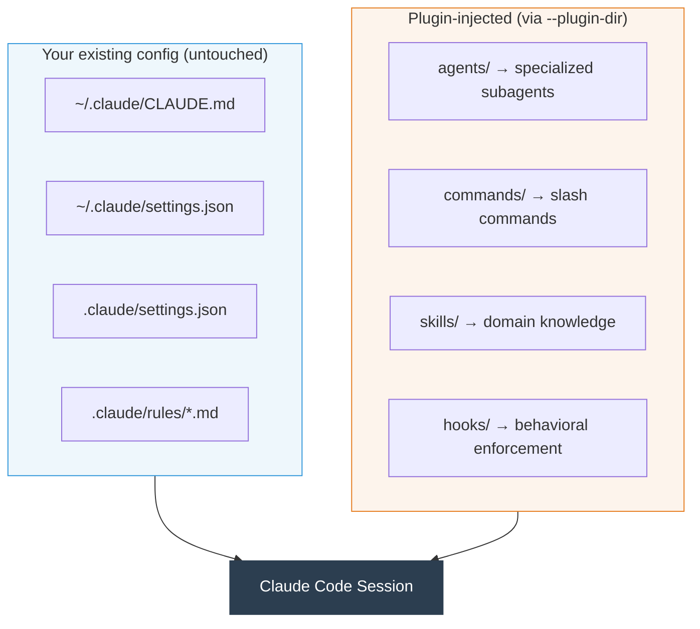
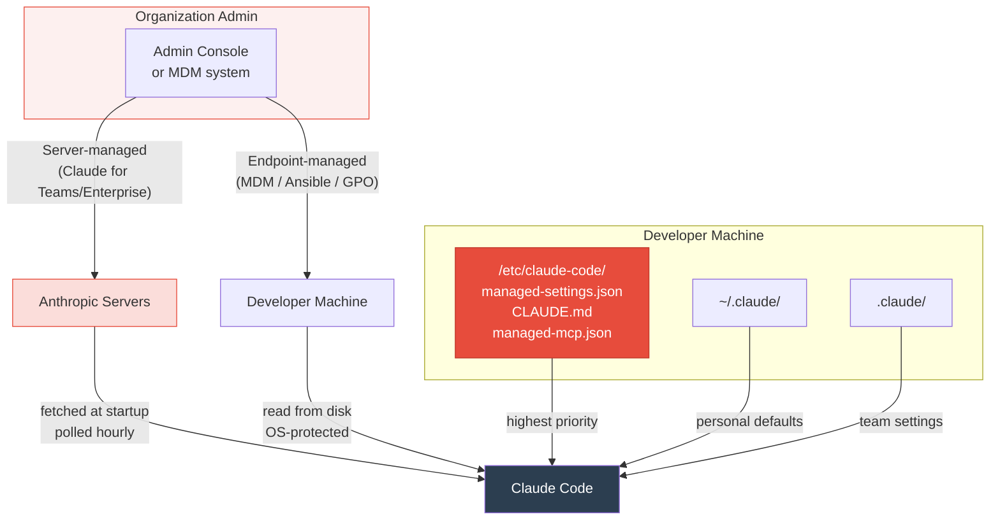
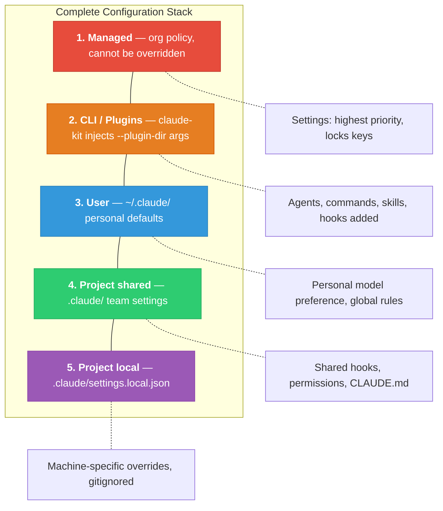
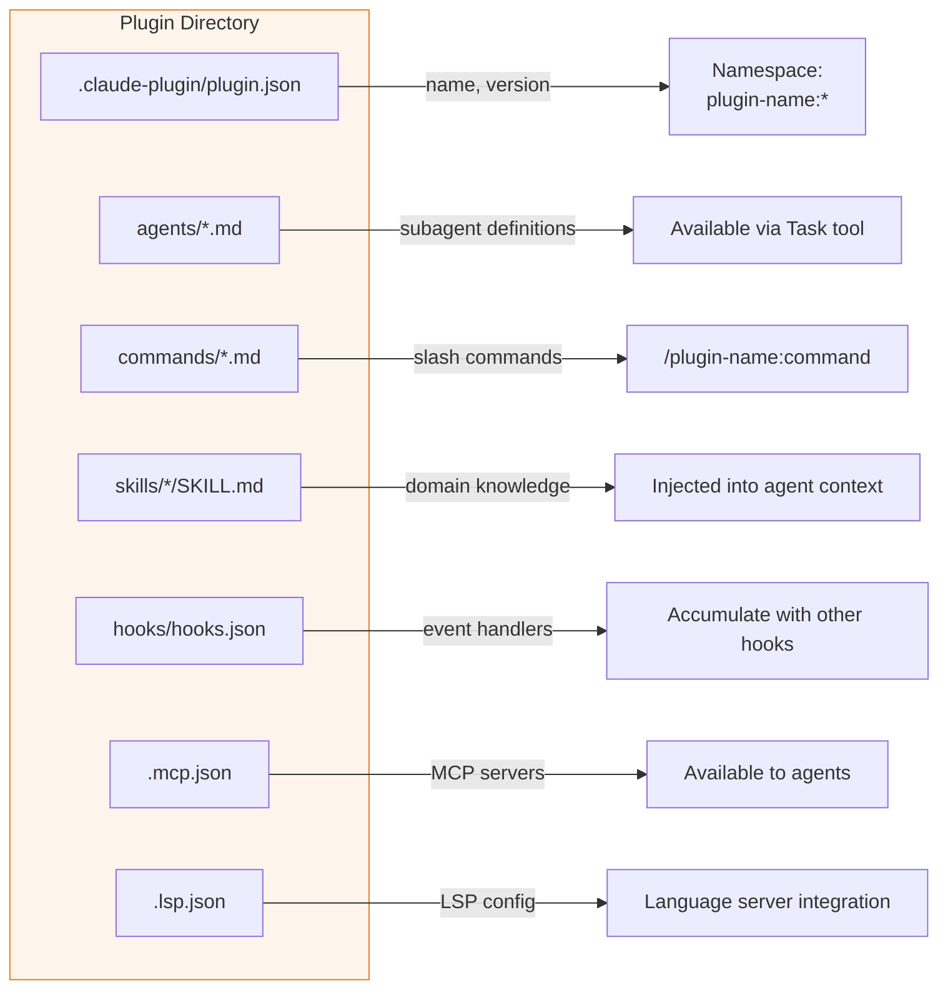

# claude-kit

[](https://github.com/MateoSegura/claude-kit/releases/latest)
[](https://github.com/MateoSegura/claude-kit/actions/workflows/push.yml)
[](https://github.com/MateoSegura/claude-kit/actions/workflows/pr.yml)

Specialized Claude Code plugins for your team. One command launches a domain expert — with companion knowledge and the right tools loaded automatically.

## Install

```bash
curl -fsSL https://raw.githubusercontent.com/MateoSegura/claude-kit/main/install.sh | bash
```

Requires: `git`, `python3`. Claude Code CLI and `jq` are installed automatically if missing.

## Usage

```bash
# List available kits
claude-kit list

# Launch a full team by domain prefix (loads all related plugins)
claude-kit --kit coding-embedded-zephyr
claude-kit --kit coding-frontend-svelte

# Launch a specific plugin
claude-kit --kit coding-embedded-zephyr-engineer

# Combine kits in one session
claude-kit --kit coding-embedded-zephyr-engineer --kit core-spec

# Skip permission prompts
claude-kit --kit coding-embedded-zephyr --yolo

# Choose model (default: opus)
claude-kit --kit coding-embedded-zephyr --model sonnet

# Check current version and look for updates
claude-kit version

# Pull latest plugins
claude-kit update

# Set up Claude Code features (status line)
claude-kit setup

# Validate plugin structure (Tier 1: JSON, fields, hooks)
claude-kit validate --all
claude-kit validate coding-embedded-zephyr-engineer

# Undo setup changes
claude-kit restore

# Remove claude-kit from this machine
claude-kit uninstall
```

---

## How It Works

claude-kit builds on Claude Code's native configuration hierarchy — it doesn't replace it, bypass it, or modify it. It's a thin launcher that resolves plugins and calls `claude` with `--plugin-dir` arguments, then exits. After launch, claude-kit is not running — it's just Claude Code with more plugins loaded.

### Claude Code's Configuration Hierarchy

Claude Code reads configuration from four scopes, each overriding the one below it:



| Scope | Settings | Instructions | Hooks | MCP |
|-------|----------|-------------|-------|-----|
| **Managed** | `managed-settings.json` | `CLAUDE.md` | Yes (can be exclusive) | `managed-mcp.json` |
| **User** | `~/.claude/settings.json` | `~/.claude/CLAUDE.md` | Yes | In settings or `~/.claude.json` |
| **Project (shared)** | `.claude/settings.json` | `CLAUDE.md` + `.claude/rules/*.md` | Yes | `.mcp.json` |
| **Project (local)** | `.claude/settings.local.json` | `CLAUDE.local.md` | No | No |

**Settings** follow a strict override chain — for any key, the highest-priority source wins: `managed > CLI args > project local > project shared > user`.

**Instructions** (CLAUDE.md and rules) are **concatenated, not overridden**. Claude sees all of them, from all scopes, in every turn.

**Hooks** from all scopes **run in parallel**. A user hook, project hook, and managed hook matching the same event all fire. Identical commands are deduplicated.

### For Individuals

An individual developer has two active scopes: **user** (`~/.claude/`) and **project** (`.claude/`).



claude-kit does not create or modify any of these files. When you run `claude-kit --kit coding-embedded-zephyr`, it resolves the plugins, then launches Claude Code with `--plugin-dir` arguments:



The result is Claude Code running with all your normal config **plus** plugin-injected components:



Plugins compose cleanly because Claude Code namespaces everything — commands become `/plugin-name:command-name`, agents are scoped to their plugin, hooks accumulate alongside existing hooks, and no file on disk is modified.

### For Organizations

Organizations add a fifth, highest-priority scope: **managed configuration**. This scope cannot be overridden by users or projects.



| | Server-managed | Endpoint-managed |
|---|---|---|
| **How deployed** | Anthropic Admin Console | MDM, Ansible, Group Policy |
| **Delivery** | Cloud fetch at startup, polled hourly | Static file on disk |
| **Offline** | Uses cached settings | Always available |
| **Protection** | Client-side (bypassable on unmanaged devices) | OS-level file protection |
| **Best for** | Teams without MDM, BYOD | Managed corporate devices |
| **If both exist** | Server-managed wins | — |

Managed-only keys that cannot be set at any lower scope:

| Key | Effect |
|-----|--------|
| `disableBypassPermissionsMode` | Prevents `--dangerously-skip-permissions` and "Act" mode |
| `allowManagedPermissionRulesOnly` | Blocks all user/project permission rules — only org rules apply |
| `allowManagedHooksOnly` | Blocks all user/project/plugin hooks — only org hooks run |
| `strictKnownMarketplaces` | Controls which plugin marketplace sources users can install from |

When an organization deploys managed settings AND a developer uses claude-kit, all five layers compose:



**Important:** If an organization sets `"allowManagedHooksOnly": true`, all plugin hooks are suppressed. Agents, commands, and skills still load — but behavioral enforcement hooks (PreToolUse guards, PostToolUse linting, Stop verification) are blocked. Organizations deploying claude-kit should either leave this as `false`, or replicate essential plugin hooks in managed settings.

---

## Why Agent Teams?

A single agent trying to be a firmware engineer, a code reviewer, a test writer, and a domain expert simultaneously hits **context dilution**. When you ask one agent to do everything, its instructions grow unbounded, its tool access is unrestricted, and there's no enforcement of what "good" looks like for each role.

claude-kit solves this with **specialized agent teams** — multiple Claude agents, each expert at one thing, working together in a single session.

### The Team Role Model

Every domain team in claude-kit has a core set of roles:

```
Knowledge ──► Engineer
     └──────► Grader
     └──────► Tester
     └──────► Debugger
```

| Role | Responsibility | Key design principle |
|------|---------------|---------------------|
| **Knowledge** | Domain reference — APIs, patterns, hardware specs | No agents, no commands. Pure skill injection. |
| **Engineer** | Active implementation — writes, builds, scaffolds | Loads knowledge as companion. Hooks enforce hard constraints. |
| **Grader** | Blind quantitative review — scores code across weighted dimensions | Isolated from engineer context. Never writes code. |
| **Tester** | Test engineering — writes tests, runs coverage, validates CI | Own test knowledge. Never touches production code. |
| **Debugger** | Failure diagnosis — triages crashes, profiles, traces | Read-only. Never writes or modifies code. |

Each role requires a different permission model, different tool access, and different hard constraints:

- The **engineer** needs write access and aggressive build-and-fix loops
- The **grader** needs read-only access and must be blind to who wrote the code
- The **tester** needs write access but only to test files, never source files
- The **debugger** needs read-only access to logs, traces, and code for diagnosis
- The **knowledge** plugin provides shared domain context without polluting any role's instructions

### How Plugins Use Claude's Architecture

**Skills = context injection, not instructions.** A `skill` file is preloaded verbatim into an agent's context at launch. The knowledge plugin's skills — kernel API references, hardware specs, design patterns — are injected into the engineer's context automatically, giving it domain expertise without bloating its own instructions.

**Agents = focused subagents.** When you run `/coding-embedded-zephyr-engineer:develop`, the `develop` command spawns specialized subagents in parallel. Each subagent has `tools:` restricted to exactly what it needs, `skills:` preloaded with the right reference material, and `permissionMode:` set to `plan` for read-only agents or `acceptEdits` for writers.

**Hooks = behavioral enforcement, not guidelines.** Every plugin uses hooks to enforce hard constraints:
- **PreToolUse `command` hooks** block dangerous shell commands before they run (exit 2 = block)
- **PostToolUse `prompt` hooks** review code changes for anti-patterns using a focused Claude evaluation
- **PostToolUse `agent` hooks** run multi-step verification that requires reading files
- **Stop `agent` hooks** verify deliverable quality before Claude is allowed to stop

**Commands = orchestration, not implementation.** A `command` file coordinates a workflow by spawning agents. The command itself never writes code — it gathers requirements, launches specialized agents, synthesizes results, and presents output.

### What claude-kit actually does



claude-kit is a thin launcher. It:

1. **Resolves** the kit name to plugin directories (prefix matching + companion resolution)
2. **Deduplicates** companion plugins that appear in multiple dependency chains
3. **Orders** companions before the plugins that depend on them
4. **Builds** the `claude` command with repeated `--plugin-dir` flags
5. **Replaces itself** with `os.execvp("claude", args)` — claude-kit is not running during your session

After launch, it's just Claude Code with more plugins loaded. claude-kit is gone.

---

## Plugins

### Zephyr RTOS Team

Five plugins covering the full development lifecycle for Zephyr RTOS embedded firmware. The knowledge plugin is auto-loaded as a companion by the other four, injecting kernel APIs, devicetree syntax, hardware targets, and design patterns into their agent context.

```bash
claude-kit --kit coding-embedded-zephyr  # loads all five
```

| Plugin | Role | README |
|--------|------|--------|
| `coding-embedded-zephyr-knowledge` | Knowledge | [→ README](plugins/coding-embedded-zephyr-knowledge/README.md) |
| `coding-embedded-zephyr-engineer` | Engineer | [→ README](plugins/coding-embedded-zephyr-engineer/README.md) |
| `coding-embedded-zephyr-grader` | Grader | [→ README](plugins/coding-embedded-zephyr-grader/README.md) |
| `coding-embedded-zephyr-tester` | Tester | [→ README](plugins/coding-embedded-zephyr-tester/README.md) |
| `coding-embedded-zephyr-debugger` | Debugger | [→ README](plugins/coding-embedded-zephyr-debugger/README.md) |

### Svelte Frontend Team

Five plugins for Svelte 5 / SvelteKit development. The knowledge plugin is auto-loaded as a companion, providing runes reference, SvelteKit patterns, CSS architecture, accessibility standards, and hardware communication (USB/BLE/LAN/audio/MIDI) to all role plugins.

```bash
claude-kit --kit coding-frontend-svelte  # loads all five
```

| Plugin | Role | README |
|--------|------|--------|
| `coding-frontend-svelte-knowledge` | Knowledge | [→ README](plugins/coding-frontend-svelte-knowledge/README.md) |
| `coding-frontend-svelte-engineer` | Engineer | [→ README](plugins/coding-frontend-svelte-engineer/README.md) |
| `coding-frontend-svelte-grader` | Grader | [→ README](plugins/coding-frontend-svelte-grader/README.md) |
| `coding-frontend-svelte-tester` | Tester | [→ README](plugins/coding-frontend-svelte-tester/README.md) |
| `coding-frontend-svelte-debugger` | Debugger | [→ README](plugins/coding-frontend-svelte-debugger/README.md) |

### Python Cloud Backend Team

Five plugins covering the full development lifecycle for Python cloud-backend microservices (FastAPI, gRPC, asyncio, SQLAlchemy 2.0, Docker, Kubernetes). The knowledge plugin is auto-loaded as a companion by the other four, injecting asyncio patterns, distributed systems reference, container orchestration, and design patterns into their agent context.

```bash
claude-kit --kit coding-cloud-python  # loads all five
```

| Plugin | Role | README |
|--------|------|--------|
| `coding-cloud-python-knowledge` | Knowledge | [→ README](plugins/coding-cloud-python-knowledge/README.md) |
| `coding-cloud-python-engineer` | Engineer | [→ README](plugins/coding-cloud-python-engineer/README.md) |
| `coding-cloud-python-grader` | Grader | [→ README](plugins/coding-cloud-python-grader/README.md) |
| `coding-cloud-python-tester` | Tester | [→ README](plugins/coding-cloud-python-tester/README.md) |
| `coding-cloud-python-debugger` | Debugger | [→ README](plugins/coding-cloud-python-debugger/README.md) |

### System Plugins

Meta-plugins for building and maintaining the plugin ecosystem itself.

| Plugin | What it does | README |
|--------|-------------|--------|
| `core-spec` | Spec-driven development for long-running sessions — write the spec first, track phases, and recover context after compaction | [→ README](plugins/core-spec/README.md) |
| `system-maker` | Build new domain plugins via a guided 11-phase workflow with parallel subagent execution | [→ README](plugins/system-maker/README.md) |
| `system-updater` | Enhance existing plugins via a structured 7-phase workflow with staging-based safety and deep review | [→ README](plugins/system-updater/README.md) |

---

## Plugin Structure

Every plugin is a directory of markdown files and JSON configs:

```
plugins/<name>/
├── .claude-plugin/
│   ├── plugin.json    # { name, description, version } — parsed by Claude Code
│   └── ctl.json       # { role, companions } — read by claude-kit
├── agents/            # subagent definitions (tools:, permissionMode:, skills:)
├── commands/          # user-invocable slash commands (allowed-tools:)
├── skills/            # domain knowledge preloaded into agent context
│   └── <skill-name>/
│       ├── SKILL.md   # entry point (max 500 lines)
│       └── reference.md
├── hooks/
│   └── hooks.json     # PreToolUse / PostToolUse / Stop handlers
└── scripts/           # shell scripts called by command hooks
```

**Critical distinction:** Agents use `tools:` in frontmatter. Commands and skills use `allowed-tools:`. Using the wrong key is a silent failure.

**Companion auto-loading:** A plugin declares companions in `ctl.json`. claude-kit loads them first, before the requesting plugin. The engineer always gets the knowledge plugin's skills injected before its own agents launch.

---

## For Plugin Developers

```bash
# Create a new plugin (guided 11-phase workflow)
claude-kit --kit system-maker
# → /system-maker:make-agent

# Enhance an existing plugin (6-phase workflow)
claude-kit --kit system-updater
# → /system-updater:update-agent

# Validate your plugin before committing
claude-kit validate --all          # Tier 1: JSON, fields, hooks
claude-kit validate --changed      # only files changed since last commit
# → /system-maker:validate         # Tier 2-4: semantic review
```

**Branch naming is enforced by CI:** `<type>/<description>`
Valid types: `feat`, `fix`, `chore`, `docs`, `test`, `refactor`, `perf`, `ci`, `build`, `style`, `release`, `hotfix`
