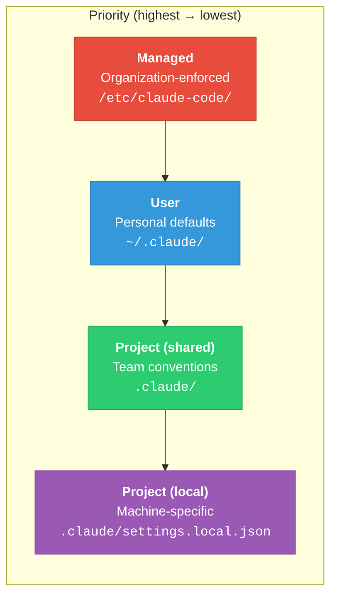
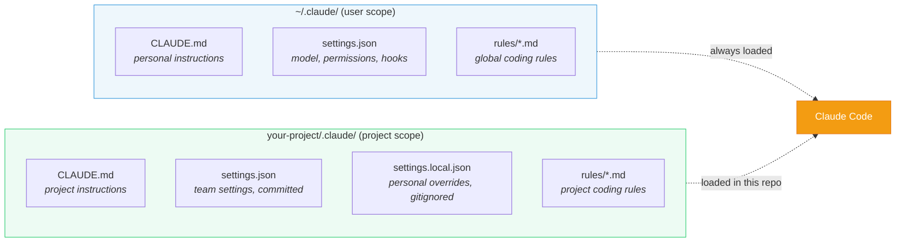
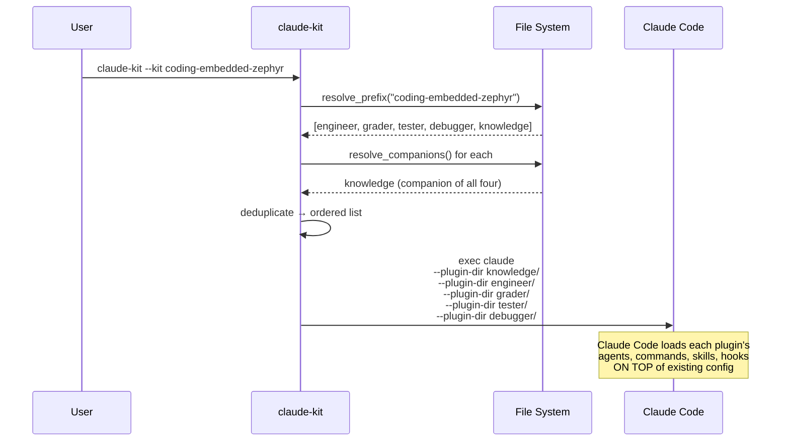
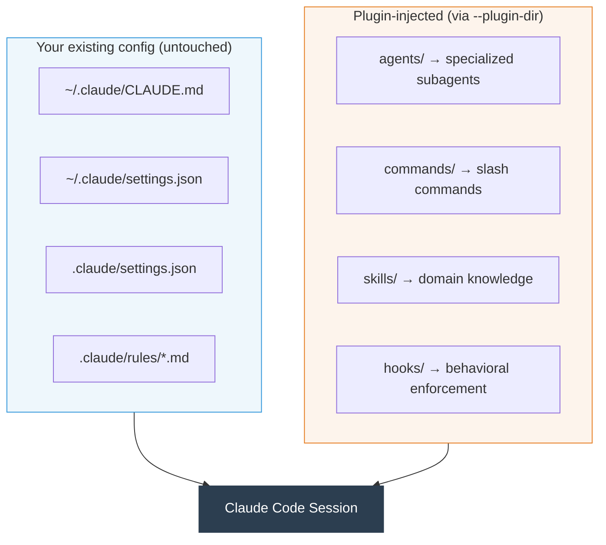
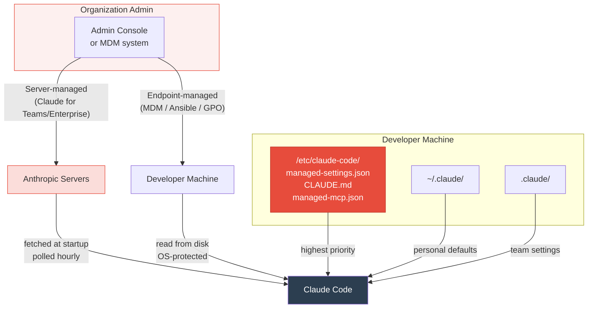
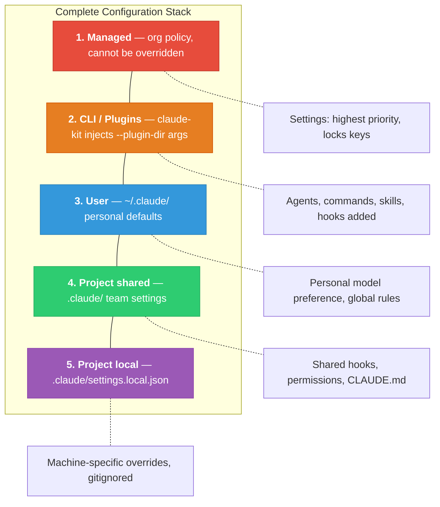
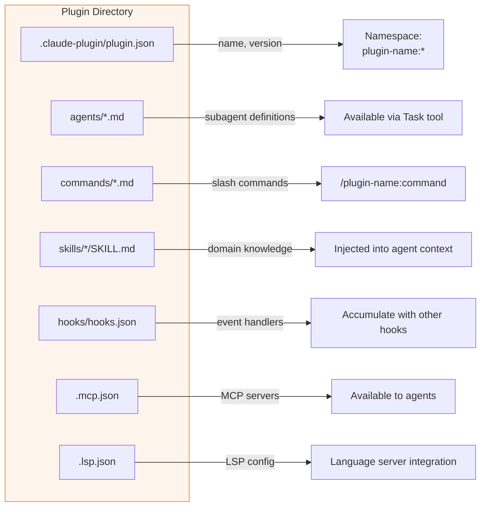

# How It Works

claude-kit builds on Claude Code's native configuration hierarchy — it doesn't replace it, bypass it, or modify it. Understanding how Claude Code loads configuration is essential to understanding what claude-kit does (and doesn't do) when it injects plugins.

---

## Claude Code Configuration Hierarchy

Claude Code reads configuration from four scopes, each overriding the one below it:



### What each scope provides

| Scope | Settings | Instructions | Hooks | MCP |
|-------|----------|-------------|-------|-----|
| **Managed** | `managed-settings.json` | `CLAUDE.md` | Yes (can be exclusive) | `managed-mcp.json` |
| **User** | `~/.claude/settings.json` | `~/.claude/CLAUDE.md` | Yes | In settings or `~/.claude.json` |
| **Project (shared)** | `.claude/settings.json` | `CLAUDE.md` + `.claude/rules/*.md` | Yes | `.mcp.json` |
| **Project (local)** | `.claude/settings.local.json` | `CLAUDE.local.md` | No | No |

### How settings merge

**Settings** follow a strict override chain. For any given key, the highest-priority source wins:

```
managed > CLI args > project local > project shared > user
```

**Instructions** (CLAUDE.md and rules) are **concatenated, not overridden**. Claude sees all of them, from all scopes, in every turn. A project CLAUDE.md does not replace the user's — both are loaded.

**Hooks** from all applicable scopes **run in parallel**. A user hook, a project hook, and a managed hook matching the same event all fire. Identical commands are deduplicated.

**Permissions** are evaluated in deny > ask > allow order. The first matching rule wins, regardless of scope.

---

## For Individuals

An individual developer has two active scopes: **user** and **project**.

### File layout



**What Claude sees at startup:**
1. `~/.claude/CLAUDE.md` — always loaded, every project
2. `~/.claude/rules/*.md` — always loaded (global rules without `path:` frontmatter)
3. `CLAUDE.md` or `.claude/CLAUDE.md` — loaded for this project
4. `.claude/rules/*.md` — loaded for this project
5. `CLAUDE.local.md` — your personal project notes (gitignored)
6. Auto-learned memory from `~/.claude/projects/<project>/memory/`

All of these are concatenated into a single system prompt. None override each other.

### Where claude-kit fits

claude-kit does not create or modify any of these files. When you run:

```bash
claude-kit --kit coding-embedded-zephyr
```

claude-kit resolves the plugins, then launches Claude Code with `--plugin-dir` arguments:



The result is Claude Code running with all your normal configuration **plus** the plugin-injected components:



Plugins compose cleanly because Claude Code namespaces everything:
- Commands become `/plugin-name:command-name`
- Agents are scoped to the plugin that defines them
- Plugin hooks accumulate alongside your existing hooks
- No file on disk is modified

---

## For Organizations

Organizations add a fifth, highest-priority scope: **managed configuration**. This scope cannot be overridden by users or projects.

### Deployment paths



### Two enforcement methods

| | Server-managed | Endpoint-managed |
|---|---|---|
| **How deployed** | Anthropic Admin Console | MDM, Ansible, Group Policy |
| **Delivery** | Cloud fetch at startup, polled hourly | Static file on disk |
| **Offline** | Uses cached settings | Always available |
| **Protection** | Client-side (bypassable on unmanaged devices) | OS-level file protection |
| **Best for** | Teams without MDM, BYOD | Managed corporate devices |
| **If both exist** | Server-managed wins | — |

**Recommendation:** Use both for defense-in-depth. Server-managed for the base policy, endpoint-managed for hard enforcement on corporate devices.

### Managed-only keys

These keys **only work in managed settings** and cannot be set at any lower scope:

| Key | Effect |
|-----|--------|
| `disableBypassPermissionsMode` | Prevents `--dangerously-skip-permissions` and "Act" mode |
| `allowManagedPermissionRulesOnly` | Blocks all user/project permission rules — only org rules apply |
| `allowManagedHooksOnly` | Blocks all user/project/plugin hooks — only org hooks run |
| `strictKnownMarketplaces` | Controls which plugin marketplace sources users can install from |

### Managed file locations

| File | Linux / WSL | macOS |
|------|------------|-------|
| Settings | `/etc/claude-code/managed-settings.json` | `/Library/Application Support/ClaudeCode/managed-settings.json` |
| Instructions | `/etc/claude-code/CLAUDE.md` | `/Library/Application Support/ClaudeCode/CLAUDE.md` |
| MCP servers | `/etc/claude-code/managed-mcp.json` | `/Library/Application Support/ClaudeCode/managed-mcp.json` |

### Full hierarchy with plugins

When an organization deploys managed settings AND a developer uses claude-kit, all five layers compose:



**Critical interaction: `allowManagedHooksOnly`**

If an organization sets `"allowManagedHooksOnly": true`, **all plugin hooks are suppressed**. Plugin agents, commands, and skills still load — but hooks (behavioral enforcement) are blocked. This means:
- Plugin PreToolUse guards (e.g., blocking dangerous commands) will not run
- Plugin PostToolUse linting (e.g., anti-pattern detection) will not run
- Plugin Stop verification (e.g., deliverable quality checks) will not run

Organizations deploying claude-kit should either leave `allowManagedHooksOnly` as `false`, or replicate the essential plugin hooks in their managed settings.

---

## How Plugin Loading Works

When Claude Code receives `--plugin-dir` arguments, it treats each directory as a self-contained plugin:



### Plugin isolation guarantees

- **Namespace isolation**: A plugin's commands and skills are prefixed with the plugin name. `/coding-embedded-zephyr-engineer:develop` cannot collide with `/coding-frontend-svelte-engineer:develop`.
- **No file mutation**: Installing a plugin never modifies `~/.claude/`, `.claude/`, or any user file. Plugins are read-only directories.
- **Hook accumulation**: Plugin hooks run alongside (not instead of) user and project hooks. All matching hooks from all sources fire in parallel.
- **Companion resolution**: claude-kit reads `ctl.json` → `companions` and loads companion plugins first, so the knowledge plugin's skills are available before any role plugin's agents reference them.

### What claude-kit actually does

claude-kit is a thin launcher. It:

1. **Resolves** the kit name to plugin directories (prefix matching + companion resolution)
2. **Deduplicates** companion plugins that appear in multiple dependency chains
3. **Orders** companions before the plugins that depend on them
4. **Builds** the `claude` command with repeated `--plugin-dir` flags
5. **Replaces itself** with `os.execvp("claude", args)` — claude-kit is not running during your session

After launch, it's just Claude Code with more plugins loaded. claude-kit is gone.
